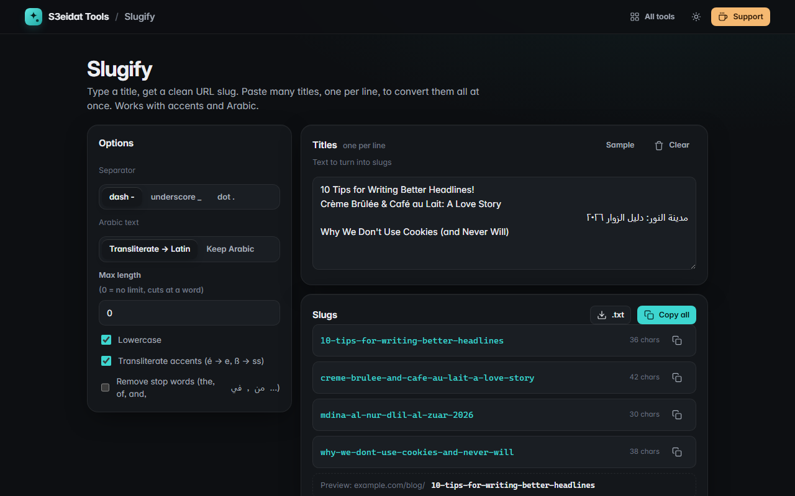

# Slugify

> Clean URL slugs from any title, including Arabic. Free, private, and it runs entirely in your browser.

### ▶ [Open Slugify](https://s3eidat.github.io/slugify/)



## Features

- Title → slug as you type: `10 Tips for Writing Better Headlines!` → `10-tips-for-writing-better-headlines`
- **Separator**: dash, underscore or dot
- **Lowercase** on or off
- **Max length** that cuts at a word boundary (never leaves a trailing separator)
- **Remove stop words** (English and Arabic), but never down to an empty slug
- **Transliterate accents** with Unicode NFD (`Crème Brûlée` → `creme-brulee`, `Straße` → `strasse`), `&` becomes `and`
- **Arabic**: transliterate to Latin with a simple table (`مدينة النور` → `mdina-al-nur`), or **keep Arabic** for a Unicode slug
  (tashkeel and tatweel removed, Arabic-Indic digits turned into 0–9). Shows the percent-encoded length too.
- **Bulk mode**: one title per line, copy each slug or all of them, download `.txt`
- Remembers your options on this device

## Privacy

Your text never leaves your device. There is no server, no account, no analytics.
The page ships with a strict Content-Security-Policy (`connect-src 'self'`), so the browser
itself blocks any attempt to send data anywhere.

## Run it yourself

It's plain HTML, CSS and JavaScript with no build step:

```bash
git clone https://github.com/s3eidat/slugify
cd slugify
python -m http.server 8000
```

Then open http://localhost:8000.

## Support

If this saved you time, **[buy me a coffee ☕](https://s3eidat.github.io/coffee/)**. It keeps every tool free.

---

Part of **[S3eidat Tools](https://s3eidat.github.io/)**: 100+ free, private tools that run in your browser. MIT licensed.
